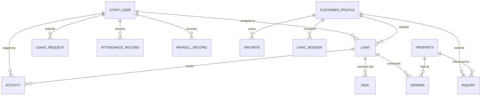

# LYKA Realty — System Architecture Documentation

This document describes the high-level architecture, component hierarchy, data pipelines, security controls, and deployment topology of the **LYKA Realty** enterprise real estate platform.

---

## 1. System Topology & Architectural Overview

The application follows a modern decoupled three-tier architecture with specialized cloud services for authentication and database management:

```mermaid
flowchart TD
    subgraph Client ["Client Tier (Browser)"]
        PublicApp["Public Website & Portal (React + Vite)"]
        StaffPortal["CRM / HRMS / Admin Dashboard"]
        VoiceAgent["Customer AI Voice Assistant"]
    end

    subgraph CDN ["Edge / CDN (Vercel)"]
        VercelEdge["Vercel Global Edge Network\n(SPA Rewrites, Asset Caching)"]
    end

    subgraph BackendTier ["Application Tier (Render Cloud)"]
        FastAPI["FastAPI Web Server (ASGI)\nHost: Render Cloud"]
        subgraph InternalModules ["FastAPI Submodules"]
            CoreConfig["Core Settings & RBAC Policy"]
            APIRouter["API Router Aggregator"]
            Middleware["CORS, Rate Limiter, Security Headers"]
            LeadEngine["Lead Routing & Continuity Engine"]
            HRMSEngine["HRMS Entitlement & Payroll"]
            AIConcierge["Ollama / OpenAI Concierge Bridge"]
        end
    end

    subgraph AuthTier ["Identity Provider (Google Firebase)"]
        FirebaseAuth["Firebase Authentication\n(Email/Password, Google OAuth, Custom Claims)"]
    end

    subgraph DataTier ["Persistence Tier (Supabase Cloud)"]
        SupaPooler["Supabase Transaction Pooler\n(AWS Sydney ap-southeast-2:5432)"]
        PostgresDB[("PostgreSQL 15 Database\n(3,000+ Properties, Leads, Staff, HRMS)")]
    end

    subgraph AITier ["Artificial Intelligence"]
        OllamaLocal["Local Ollama Instance\n(llama3.2:3b)"]
        OpenAIFallback["OpenAI Fallback API\n(gpt-4o-mini)"]
    end

    PublicApp --> VercelEdge
    StaffPortal --> VercelEdge
    VoiceAgent --> VercelEdge

    VercelEdge -->|HTTP / REST (VITE_API_URL)| FastAPI
    PublicApp -->|Client Auth| FirebaseAuth
    StaffPortal -->|Client Auth| FirebaseAuth

    FastAPI -->|Token Verification| FirebaseAuth
    FastAPI -->|SQLAlchemy / psycopg2| SupaPooler
    SupaPooler --> PostgresDB

    FastAPI -->|HTTP REST| OllamaLocal
    FastAPI -->|HTTPS API| OpenAIFallback
```

---

## 2. Frontend Architecture (`frontend/`)

### 2.1 Technology Stack
- **Framework**: React 18 with TypeScript 5.8
- **Build Tool**: Vite 8.3 (Production bundling via Rollup/Rolldown, HMR in dev)
- **Styling**: Tailwind CSS + Custom Brand Theme Tokens (Luxury Plum `#1A0B2E`, Ivory `#FAF7F0`, Gold `#C6A15B`)
- **State Management**: React Context API (`AuthContext`, `PortalContext`, `FavoritesContext`)
- **Testing**: Vitest + Testing Library (37 test suites, 379 tests)

### 2.2 Directory Structure
```text
frontend/
├── public/                 # Static assets, favicon, robots.txt
├── src/
│   ├── assets/             # Images, illustrations, luxury brand icons
│   ├── components/         # Reusable UI widgets, Modals, Cards, Filters
│   ├── pages/              # Public routes (Home, Property Details, Careers)
│   ├── layouts/            # Page shells (MainLayout, CrmLayout)
│   ├── hooks/              # Custom React hooks (useAuth, useTheme)
│   ├── services/           # External API & Firebase service adapters
│   ├── api/                # Unified API client & type exports
│   ├── context/            # AuthContext, Global Application State
│   ├── types/              # TypeScript domain interfaces (Lead, Property, Staff)
│   ├── utils/              # Data parsing, formatting, test suites
│   ├── styles/             # Global CSS and brand design tokens
│   ├── App.tsx             # Root router and view orchestrator
│   └── main.tsx            # React DOM hydration entrypoint
├── .env.example            # Template for environment variables
├── .env.local              # Local dev overrides (ignored by git)
├── package.json            # Scripts & dependencies
├── tsconfig.json           # Strict TypeScript compiler config
└── vercel.json             # Vercel SPA routing & security headers
```

---

## 3. Backend Architecture (`backend/`)

### 3.1 Technology Stack
- **Framework**: FastAPI (Python 3.11+) with Starlette and Uvicorn ASGI server
- **ORM**: SQLAlchemy 2.0 with PostgreSQL psycopg2-binary driver
- **Data Validation**: Pydantic v2 schemas
- **Auth SDK**: Firebase Admin Python SDK
- **AI Integrations**: Ollama HTTP API + OpenAI SDK

### 3.2 Directory Structure
```text
backend/
├── app/
│   ├── api/                # Router aggregation (routes.py)
│   ├── core/               # App configuration (config.py) and RBAC security (security.py)
│   ├── database/           # Database engine, session factory, and auto-migrations
│   ├── middleware/         # CORS, Rate Limiting, and Security Headers
│   ├── models/             # SQLAlchemy ORM entity definitions
│   ├── schemas/            # Pydantic request and response schemas
│   ├── services/           # Domain logic (Lead, HRMS, AI, Property Analytics)
│   ├── utils/              # Formatting, timestamp, and UUID helpers
│   └── main.py             # FastAPI entrypoint, lifespan startup, health endpoint
├── tests/                  # 42 self-resolving integration test suites
├── render.yaml             # Render Cloud deployment blueprint
├── requirements.txt        # Python pip dependencies
├── .env.example            # Server-side environment variable template
└── README.md               # Backend developer guide
```

---

## 4. Database Architecture (Supabase Cloud PostgreSQL)

The database runs on Supabase Cloud PostgreSQL with connection pooling on AWS Sydney (`aws-0-ap-southeast-2.pooler.supabase.com:5432`).

### 4.1 Core Entity Relationships



### 4.2 Key Tables
- `staff_users`: Internal employees, credentials, roles (`admin`, `hrms_admin`, `sales_agent`), availability status (`available`, `on_leave`, `inactive`).
- `leads`: Customer sales leads with status, priority, budget, assigned agent, and `do_not_disturb` flags.
- `properties`: Real estate listings (3,000+ mirrored entries in Dubai communities).
- `hrms_leave_requests`, `hrms_leave_balances`: Leave entitlements and approvals.
- `customer_profiles`, `customer_chat_messages`: End-user customer preferences and chat turns.

---

## 5. Security & Authorization Architecture

### 5.1 Role-Based Access Control (RBAC) Matrix

| Module / Endpoint | Anonymous | Customer | Sales Agent | HRMS Admin | Super Admin |
|:---|:---:|:---:|:---:|:---:|:---:|
| **Public Listings Search** | Read | Read | Read | Read | Read |
| **Customer AI Voice/Chat** | Allowed | Allowed | **Blocked (403)** | **Blocked (403)** | **Blocked (403)** |
| **Customer Portal / Favorites** | Denied | Read/Write | Denied | Denied | Denied |
| **CRM Leads Management** | Denied | Denied | Assigned Only | Denied | Full Access |
| **Lead Reassignment / DND** | Denied | Denied | Assigned Only | Denied | Full Access |
| **HRMS Leave / Attendance** | Denied | Denied | Self Only | Full HR Access | Full Access |
| **Admin Team Management** | Denied | Denied | Denied | Denied | Full Access |

---

## 6. AI Conversational Intelligence Architecture

- **Local Inference**: Default routing to Ollama (`llama3.2:3b`) on `http://localhost:11434`.
- **Context Injection**: Each customer prompt is enriched with:
  1. The customer's registered profile and preferences (preferred locations, budget, bedrooms).
  2. Dubai market knowledge (freehold ownership laws, Golden Visa thresholds AED 2M+, down payment rules).
  3. Dynamic property recommendations based on SQL-filtered matching.
- **Persistent Voice Loop**: Real-time microphone capture with 1,200ms silence detection and interruption handling.

